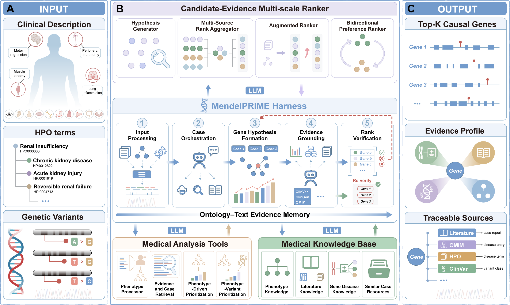

# MendelPRIME

MendelPRIME is an agent system for causal-gene prioritization in Mendelian
disorders. It integrates heterogeneous patient information with specialized
medical tools and knowledge retrieval to compare competing genetic hypotheses.
The system accepts HPO terms alone, HPO terms with clinical descriptions, or
HPO terms with genomic variants.

In the cohorts evaluated in our study, MendelPRIME achieved state-of-the-art
causal-gene prioritization performance among the compared methods in both
phenotype-driven and joint phenotype-variant evaluations. Optional traceable
reports summarize the case, explain supporting and conflicting evidence, and
compare leading candidates with references to databases and literature. For VCF
inputs, reports also include variant-level ACMG interpretation. Case and Cohort
workflows share the same interface, with resource profiles for ranking alone or
ranking with reports.

[Quick start](#quick-start) | [Demos](examples/README.md) |
[Resources](#resources-and-configuration) | [Documentation](#documentation)



**Figure 1. Overview of MendelPRIME.** Heterogeneous patient inputs (A) are
processed through the Harness, OTEM and CEMR with medical tools and knowledge
resources (B), producing gene priorities, evidence profiles and traceable
sources (C).

## Supported inputs

All three inputs support **Case** and **Cohort** processing through `python main.py`.

| Input | Patient information | Included demo |
|---|---|---|
| HPO | Positive HPO identifiers; explicitly absent terms are optional | [Case](examples/hpo/case.json) / [Cohort](examples/hpo/cohort.jsonl) |
| HPO + clinical description | HPO identifiers and clinical text | [Case](examples/clinical/case.json) / [Cohort](examples/clinical/cohort.jsonl) |
| HPO + VCF | HPO identifiers, VCF, assembly and sample roles | [Case](examples/vcf/case.json) / [Cohort](examples/vcf/cohort.jsonl), with the simulated VCF included |

Clinical text supplements HPO input. VCF supports **trio** and **proband-only**
analysis with **GRCh37/hg19** resources. Sample roles must be specified; column
order is not a pedigree. See [input schemas](docs/INPUTS.md).

The HPO and VCF demos share one published phenotype profile[^phenopackets].
The clinical demo is a separate published case with a short narrative containing
biochemical measurements and ultrasound findings[^clinical-demo]. The VCF uses a public GIAB
background[^giab] with a simulated variant, not clinical sequencing from that
patient. It was selected from a completed evaluation with the causal gene at
Top1. [Demo provenance and reference results](examples/README.md#data-and-reference-result)
are separate from inference inputs.

## Tools and knowledge

| Mode | Tools and resources |
|---|---|
| Shared | HPO[^hpo], local OMIM[^omim], PubMed[^pubmed]/PMC[^pmc], and a configured LLM |
| HPO / HPO+clinical | Built-in HPOOverlap and Phen2Disease[^phen2disease]; online Phen2Gene[^phen2gene] and AMELIE[^amelie] |
| VCF ranking | Local Exomiser[^exomiser], LIRICAL[^lirical] and AutoPVS1[^autopvs1]; ClinVar[^clinvar], ClinGen[^clingen], reference FASTA, gnomAD[^gnomad], SpliceAI[^spliceai], REVEL[^revel] and AI-CURA[^aicura] ranking knowledge |
| VCF report | Ranking resources plus VEP[^vep], MANE[^mane], full AI-CURA guidance and ClinGen SVI; optional GeneReviews[^genereviews] and PLINK2[^plink2] enrichment |
| Optional RareA retrieval | RareA[^rarea] records and vectors, Qwen3-Embedding[^qwen] and MedCPT[^medcpt] |

Exomiser and LIRICAL run through Java. HPO/clinical input needs no Java or variant
databases. Reports are optional; RareA and Reflection are disabled in the minimal
profiles. LLM, literature and configured evidence services require network access.

## Quick start

Use **Linux x86-64 and Python 3.12**. The current repository includes the installer;
the resource archives remain pinned to Release 1.0.0. Use a current checkout, not
the original 1.0.0 source archive, for the installation commands below.

```bash
git clone https://github.com/Pumpo97/MendelPRIME.git
cd MendelPRIME
export CODE="$PWD"
export WORK="$HOME/mendelprime-work"
export CFG="$WORK/configs"
export INPUT="$CODE/examples"
export OUT="$WORK/outputs"
export RES="$WORK/resources"
read -r -p "LLM base URL: " MENDELPRIME_BASE_URL
read -r -p "Model ID supported by that endpoint: " MENDELPRIME_MODEL
export MENDELPRIME_BASE_URL MENDELPRIME_MODEL
```

### Choose what to install

Run **one** of these commands. HPO and clinical input share one installation.
The phenotype-upload flag authorizes the later inference calls to Phen2Gene and
AMELIE; omit it if those uploads are not authorized, in which case their branches
will remain unavailable. Installation itself sends no patient or LLM requests.

```bash
# HPO or HPO + clinical description, with optional reports:
python3.12 install.py --input-type hpo --work "$WORK" --download-resources --ack-phenotype-upload

# HPO + VCF, ranking without reports:
python3.12 install.py --input-type vcf --work "$WORK" --download-resources

# HPO + VCF, ranking and reports:
python3.12 install.py --input-type vcf --report --work "$WORK" --download-resources
```

The installer creates an isolated environment, installs the selected Python
dependencies, verifies/extracts the selected Release assets, generates the TOML
pair below and runs `doctor`. **It does not obtain every external database.**
Missing native tools or data produce a nonzero exit with the missing checks;
prepare those items using the [resource-to-parameter map](docs/INSTALL.md#resource-to-parameter-map),
edit the generated resource TOML when paths differ, and rerun the same installer.
Existing configurations and different resource files are never overwritten.

| Selected capability | Generated run configuration | Resources added by reports |
|---|---|---|
| HPO / clinical | `$CFG/phenotype-rank/run.toml` | None; add `--explanation` when running |
| VCF ranking | `$CFG/vcf-rank/run.toml` | Not applicable |
| VCF with reports | `$CFG/vcf-report/run.toml` | VEP/cache/FASTA, MANE, full AI-CURA guidance and ClinGen SVI |

Each run file has an adjacent `resources.toml`. The installer sets `resource_root`
to the actual absolute resource directory. Add `--resources /existing/resources`
to reuse an installation, or `--archives /downloads` instead of
`--download-resources` to import already downloaded archives. Without either
archive option, installed resources are reused in place. `--plan` shows the
selected packages without changing files. See [installation options](docs/INSTALL.md)
for offline wheels, Java, RareA and configuration-only use.

**LIRICAL uses the prepared Release ZIP by default**, not a source build. The
installer keeps its JAR and complete `lib/` together. Java 17, LIRICAL's data and
the shared Exomiser databases must still be installed and configured. See
[LIRICAL installation](docs/LIRICAL.md) and [native-tool resources](docs/INSTALL.md#resource-to-parameter-map).

### Activate and supply the key

After the selected resource checks pass:

```bash
source "$WORK/.venv/bin/activate"
read -r -s -p "LLM API key: " MENDELPRIME_API_KEY
export MENDELPRIME_API_KEY
printf '\n'
```

The key is never written into the generated TOML. The endpoint and model ID are
user-supplied; `.env` files are not loaded automatically. HTTPS verification stays
enabled. The generated profiles use **one case lane, four global LLM slots,
Reflection off and RareA off** unless RareA was explicitly selected.

## Run a Case or Cohort

`run` is a subcommand of `main.py`, not a second script. A Case is one JSON/YAML
record; a Cohort JSONL has one record per line. Each included Cohort contains the
same single demo as its Case file; append your own unique cases for a real batch.
Run from `$CODE`. Use a fresh output directory for every invocation.

### HPO

```bash
python main.py run --config "$CFG/phenotype-rank/run.toml" --input "$INPUT/hpo/case.json" --output-root "$OUT/hpo_case" --cache-root "$WORK/cache/hpo_case"
python main.py run --config "$CFG/phenotype-rank/run.toml" --input "$INPUT/hpo/cohort.jsonl" --output-root "$OUT/hpo_cohort" --cache-root "$WORK/cache/hpo_cohort"
```

Add `--explanation` to either command for a report, with a new output directory.
No variant resources or additional tools are required.

### HPO plus clinical description

```bash
python main.py run --config "$CFG/phenotype-rank/run.toml" --input "$INPUT/clinical/case.json" --output-root "$OUT/clinical_case" --cache-root "$WORK/cache/clinical_case"
python main.py run --config "$CFG/phenotype-rank/run.toml" --input "$INPUT/clinical/cohort.jsonl" --output-root "$OUT/clinical_cohort" --cache-root "$WORK/cache/clinical_cohort"
```

Use the same installation and resources as HPO. The input adds
`clinical_description`; add `--explanation` for a report.

### HPO plus VCF

Ranking only, after the VCF ranking installation passes:

```bash
python main.py run --config "$CFG/vcf-rank/run.toml" --input "$INPUT/vcf/case.json" --output-root "$OUT/vcf_case" --cache-root "$WORK/cache/vcf_case"
python main.py run --config "$CFG/vcf-rank/run.toml" --input "$INPUT/vcf/cohort.jsonl" --output-root "$OUT/vcf_cohort" --cache-root "$WORK/cache/vcf_cohort"
```

With reports, after the VCF report installation passes:

```bash
python main.py run --config "$CFG/vcf-report/run.toml" --input "$INPUT/vcf/case.json" --output-root "$OUT/vcf_case_report" --cache-root "$WORK/cache/vcf_case_report"
python main.py run --config "$CFG/vcf-report/run.toml" --input "$INPUT/vcf/cohort.jsonl" --output-root "$OUT/vcf_cohort_report" --cache-root "$WORK/cache/vcf_cohort_report"
```

Do not simply add `--explanation` to an unprepared VCF ranking configuration:
report resources must also be present. Trio versus proband-only is specified in
the input's `genomic.family_mode` and sample roles, not by installing different
databases. The included VCF demo is proband-only.

[Complete demo commands](examples/README.md#commands) cover all Case/Cohort and
report combinations. Use a new output directory for each run. VCF paths resolve
relative to the input manifest, so the supplied demo needs no path rewriting.

## Outputs

Each case produces exactly two files:

```text
outputs/hpo_case/demo_hpo/demo_001/
  result.json
  traceable_explanation.md
```

`result.json` contains stage rankings, the final ranking, status and evidence
provenance. `traceable_explanation.md` is empty when reports are off. Reports can
also be generated later from saved results without reranking:

```bash
python main.py explain --config "$CFG/vcf-report/run.toml" --input "$OUT/vcf_case" --output-root "$OUT/vcf_explained" --cache-root "$WORK/cache/vcf_explained"
python main.py evaluate --input "$OUT/vcf_case" --truth "$INPUT/truth.csv"
```

Use the phenotype profile for saved HPO/clinical results. Gold labels are used
only by `evaluate`. Existing case outputs are not overwritten. Exit codes are
`0` for success, `2` for degradation and `1` for failure or invalid setup.
[Recovery and report controls](docs/EXECUTION.md) describe partial failures.

## Resources and configuration

Source code, demo data and large resource packages are distinct. Download the six
prepared archives from the [1.0.0 release](https://github.com/Pumpo97/MendelPRIME/releases/tag/1.0.0),
along with [ASSETS.json](https://github.com/Pumpo97/MendelPRIME/releases/download/1.0.0/ASSETS.json)
and [SHA256SUMS](https://github.com/Pumpo97/MendelPRIME/releases/download/1.0.0/SHA256SUMS).
External resources remain subject to their own access and licensing terms.
The six prepared archives are **not** a complete installation. Start with the
[resource-set checklist](resources/README.md#choose-the-smallest-resource-set)
and obtain only the additional files needed for your selected profile.

| Capability | Ready-made packages | Obtain or prepare separately |
|---|---|---|
| HPO / clinical, with or without reports | HPO ontology, statistics and gene annotations | Full OMIM JSONL + `mim2gene`; Phen2Disease four-file dataset; LLM and phenotype-service access |
| VCF ranking | HPO, ClinVar SQLite, AI-CURA ranking guidance, LIRICAL CLI | OMIM; Java 17; Exomiser 14.0.0 and 2406 genome/phenotype data; LIRICAL data including HGNC[^hgnc]; ClinGen validity/VCEP; GRCh37 FASTA/indexes; gnomAD, SpliceAI, REVEL; AutoPVS1 source/data |
| Add VCF reports | Reuse the ranking resources | VEP 104.3/cache/FASTA; MANE; full AI-CURA protocol/workbook; ClinGen SVI guidance |
| Add RareA retrieval | RareA records/IDs/vectors and retrieval support | Matching Qwen weight shards; `.[hpo]` or `.[full]` Python dependencies |

**VCF ranking still uses pre-ranking ACMG when reports are off.** The report
switch controls post-ranking ACMG and narrative generation. Ranking-only does
not load VEP, MANE or the original AI-CURA protocol/workbook unless ranking VEP
is explicitly enabled. It still needs gnomAD, SpliceAI, REVEL and AutoPVS1;
Exomiser summary annotations do not replace these resources.

- [Prepared archives and extraction](docs/RESOURCE_ASSETS.md): HPO, ClinVar, guidance, RareA, retrieval support and LIRICAL.
- [Resource-to-parameter map](docs/INSTALL.md#resource-to-parameter-map): what the installer supplies, what to obtain separately, and the exact TOML fields.
- [Acquisition and version requirements](docs/RESOURCE_PREPARATION.md) and [preprocessing commands](preparation/README.md): references, predictors, ClinGen and AutoPVS1.
- [OMIM mirror schema](docs/OMIM_MIRROR.md): normalized local JSONL; no OMIM API key is used.
- [LIRICAL installation/build](docs/LIRICAL.md) and [VEP installation/mounts](docs/VEP_RUNTIME.md): full programs, not isolated JARs or executables.
- [Parameter reference](docs/CONFIGURATION.md) and [resource inventory](docs/RESOURCE_REGISTER.md): effective defaults, paths and companion indexes.

## Documentation

| Task | Guide |
|---|---|
| Try a demo or prepare patient inputs | [Demos](examples/README.md), [input schema](docs/INPUTS.md) |
| Install or configure a deployment | [Installation](docs/INSTALL.md), [configuration](docs/CONFIGURATION.md) |
| Obtain tools and databases | [Resource setup](#resources-and-configuration) |
| Generate reports, evaluate or recover failures | [Execution](docs/EXECUTION.md) |

## Resources and references

We thank the contributors of the tools and databases below, including RareA and
the original case-report authors. Cite the resources used in your analysis and
follow their version-specific licenses. MendelPRIME also uses Python[^python],
Java[^java], optional udocker[^udocker] and the libraries listed in `pyproject.toml`.

[^hpo]: Human Phenotype Ontology. [HPO project](https://hpo.jax.org/).
[^omim]: Online Mendelian Inheritance in Man. [OMIM](https://www.omim.org/).
[^pubmed]: NCBI PubMed. [Literature database](https://pubmed.ncbi.nlm.nih.gov/).
[^pmc]: PubMed Central. [Full-text archive](https://pmc.ncbi.nlm.nih.gov/).
[^phen2disease]: Phen2Disease. [Official repository](https://github.com/ZhuLab-Fudan/Phen2Disease).
[^phen2gene]: Phen2Gene. [Official repository](https://github.com/WGLab/Phen2Gene).
[^amelie]: AMELIE. [Service](https://amelie.stanford.edu/) and [publication](https://pubmed.ncbi.nlm.nih.gov/32434849/).
[^exomiser]: Exomiser. [Official repository](https://github.com/exomiser/Exomiser).
[^lirical]: LIRICAL. [Official repository](https://github.com/TheJacksonLaboratory/LIRICAL).
[^autopvs1]: AutoPVS1. [Official repository](https://github.com/JiguangPeng/autopvs1).
[^clinvar]: ClinVar and its submitters. [NCBI ClinVar](https://www.ncbi.nlm.nih.gov/clinvar/).
[^clingen]: ClinGen, its expert panels and SVI working group. [ClinGen](https://clinicalgenome.org/).
[^gnomad]: Genome Aggregation Database and contributing studies. [gnomAD](https://gnomad.broadinstitute.org/).
[^spliceai]: SpliceAI. [Official repository](https://github.com/Illumina/SpliceAI).
[^revel]: REVEL. [Official resource](https://sites.google.com/site/revelgenomics/).
[^aicura]: AI-CURA. [Paper and supplementary material](https://doi.org/10.1126/scitranslmed.adz4172).
[^vep]: Ensembl Variant Effect Predictor. [Documentation](https://www.ensembl.org/info/docs/tools/vep/index.html).
[^mane]: MANE, NCBI RefSeq and EMBL-EBI. [Matched transcript resource](https://www.ncbi.nlm.nih.gov/refseq/MANE/).
[^qwen]: Qwen3-Embedding-4B. [Model repository](https://huggingface.co/Qwen/Qwen3-Embedding-4B).
[^medcpt]: MedCPT Cross-Encoder. [NCBI model repository](https://huggingface.co/ncbi/MedCPT-Cross-Encoder).
[^rarea]: RareA similar-case corpus. [Prepared records and vector index](docs/RESOURCE_ASSETS.md#asset-contents); original references are retained in the records.
[^plink2]: PLINK 2. [Documentation](https://www.cog-genomics.org/plink/2.0/).
[^genereviews]: GeneReviews. [NCBI Bookshelf](https://www.ncbi.nlm.nih.gov/books/NBK1116/).
[^hgnc]: HUGO Gene Nomenclature Committee. [HGNC](https://www.genenames.org/).
[^python]: Python. [Python 3.12 documentation](https://docs.python.org/3.12/).
[^java]: OpenJDK. [JDK 17 project](https://openjdk.org/projects/jdk/17/).
[^udocker]: udocker, an optional VEP container runtime. [Official repository](https://github.com/indigo-dc/udocker).
[^phenopackets]: Robinson and contributors. [384 Phenopackets, version 1.0](https://doi.org/10.5281/zenodo.3905420), CC-BY-4.0.
[^clinical-demo]: Vajro et al. (2018), Patient 3. [Published clinical and laboratory observations](https://doi.org/10.1186/s13023-017-0757-3), CC-BY-4.0.
[^giab]: Genome in a Bottle. [NIST project](https://www.nist.gov/programs-projects/genome-bottle); [public NIST VCF](https://ftp-trace.ncbi.nlm.nih.gov/ReferenceSamples/giab/data/NA12878/Garvan_NA12878_HG001_HiSeq_Exome/project.NIST.hc.snps.indels.vcf).
